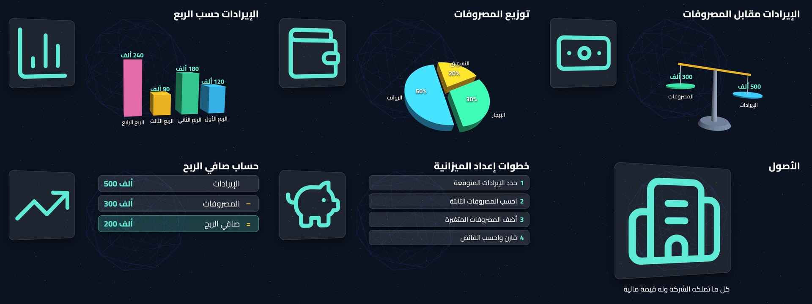
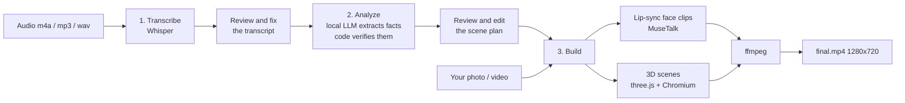
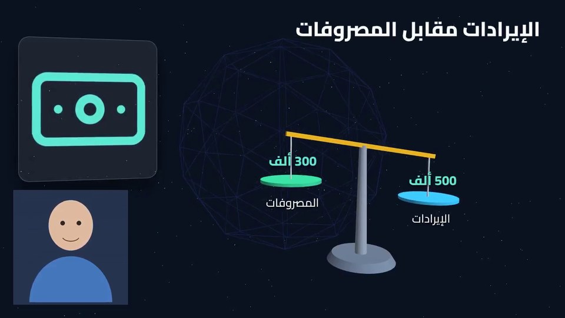
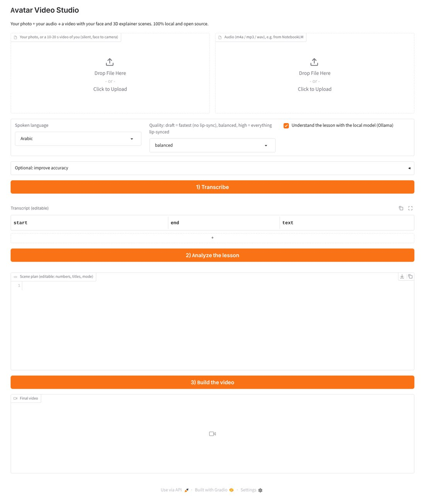

# Avatar Video Studio

**Your photo + an audio file → a video with your face and animated 3D explainer scenes.**
Built for explainer content (business, accounting, finance, education): the system *listens* to the lesson, understands what is being said, and puts matching numbers, charts, equations and icons on screen while you "speak".

- 🧠 **Understands the audio**: transcribes it, understands the lesson, and extracts facts (numbers, comparisons, steps, definitions).
- ✅ **Never shows a number you did not say**: every number must be backed by the exact words from the audio, and equation results are computed by code, not by the AI.
- 🎬 **3D scenes**: bar charts, donut charts, a balance scale, step-by-step equations, step cards, concept cards.
- 🧑 **Your face**: lip-sync from your photo or a short video of you ([MuseTalk](https://github.com/TMElyralab/MuseTalk)).
- 🔒 **100% local & open source**: no cloud API, no API key, nothing leaves your machine.
- 🖥️ **Windows, macOS, Linux and Docker.**

<p align="center"></p>

> Designed and tested around **Arabic** (right-to-left layouts, Egyptian + Modern Standard Arabic number words); the transcription language is selectable.

---

## Contents
[How it works](#how-it-works) · [Quick start](#quick-start) · [Using the app](#using-the-app) · [Examples](#examples) · [Speed](#speed) · [Accuracy](#accuracy) · [Configuration](#configuration) · [Troubleshooting](#troubleshooting) · [Project layout](#project-layout) · [Licenses](#licenses) · [What is tested](#what-is-tested)

---

## How it works



| Stage | Tool | Notes |
|---|---|---|
| Transcription | [faster-whisper](https://github.com/SYSTRAN/faster-whisper) (any CTranslate2 Whisper model) | spoken Arabic numbers → digits |
| Understanding + extraction | [Qwen3](https://ollama.com/library/qwen3) via [Ollama](https://ollama.com) | runs on your machine; JSON constrained by a schema |
| Verification | plain Python (`extract.py`) | rejects numbers not literally in the audio; computes equation results |
| Lip-sync | [MuseTalk](https://github.com/TMElyralab/MuseTalk) | CUDA, Apple MPS or CPU |
| 3D scenes | three.js + headless Chromium (Playwright) | frame-by-frame, deterministic |
| Icons | [Lucide](https://lucide.dev) (2,410 icons bundled) | chosen by keywords, not generated |
| Video | ffmpeg (bundled via `imageio-ffmpeg` if not installed) | |

<p align="center"></p>

---

## Quick start

You need about **25 GB** of free disk space (weights + models) and an internet connection **once**, for the install. After that everything runs offline.

| | RAM | GPU | Notes |
|---|---|---|---|
| Minimum | 8 GB | none | use `draft` quality; lip-sync is slow on CPU |
| Recommended | 16 GB | Apple Silicon, or NVIDIA 8 GB+ | `balanced` quality |
| Comfortable | 32 GB | NVIDIA 12 GB+ | `high` quality, bigger language model |

The launcher is the same everywhere: `studio setup`, `studio run`, `studio doctor` (`./studio.sh` on macOS/Linux, `.\studio.ps1` on Windows). It installs [`uv`](https://docs.astral.sh/uv/) if needed, creates two isolated Python environments inside this folder, installs the libraries, and downloads the weights and the local language model.

### macOS (Apple Silicon)
```bash
xcode-select --install          # once, if you never did
./studio.sh setup               # one time: libraries + MuseTalk weights (~5 GB) + language model
                                # (installs Ollama with Homebrew: https://brew.sh)
./studio.sh doctor              # checks every component
./studio.sh run                 # then open http://127.0.0.1:7860
```
MuseTalk uses Apple's GPU (`mps`) when available. If you see errors or garbled faces: `MUSETALK_DEVICE=cpu ./studio.sh run`.

### Linux
```bash
./studio.sh setup               # an NVIDIA GPU is detected automatically (CUDA wheels), otherwise CPU wheels
sudo .venv/bin/python -m playwright install-deps chromium   # system libraries for Chromium, once (Debian/Ubuntu)
./studio.sh doctor
./studio.sh run
```
For an NVIDIA GPU, install the proprietary driver first (`nvidia-smi` must work).

### Windows 10/11 (PowerShell)
```powershell
.\studio.ps1 setup              # if scripts are blocked:  Set-ExecutionPolicy -Scope Process Bypass
.\studio.ps1 doctor
.\studio.ps1 run                # then open http://127.0.0.1:7860
```
`setup` installs Ollama with `winget`. If `winget` is missing, install [Ollama](https://ollama.com/download) yourself and run `setup` again. NVIDIA GPUs are detected automatically. Alternatives: **WSL2** (follow the Linux steps, best GPU support) or **Docker Desktop**.

### Docker (any OS)
```bash
docker compose up --build                                                    # CPU, open http://localhost:7860
docker compose -f docker-compose.yml -f docker-compose.gpu.yml up --build   # NVIDIA GPU (Linux, or Windows + WSL2)
```
The first start downloads the MuseTalk weights (~5 GB) and the language model into Docker volumes (the `ollama-pull` service does the model). Results appear in `./work/`.
Headless run from the container (put your files in `./data/`):
```bash
docker compose run --rm studio python studio.py generate /data/me.png /data/talk.m4a --quality balanced
```
> Docker on macOS cannot use the Apple GPU, so on a Mac the native install is much faster.

### Offline copy of everything ("install on the machine first, then copy it into the project")
```bash
studio setup            # normal install; test it
studio vendor           # copies library files, Whisper models and Chromium into this folder
studio setup --offline  # on any other machine: reinstalls from this folder, no internet
```
Ollama models already live inside the project (`models_cache/ollama`) and the MuseTalk weights in `third_party/MuseTalk/models`.

---

## Using the app

<p align="center"></p>

1. **Upload** your photo (or a 10–20 s video of you: silent, face to the camera, mouth closed, natural head) and the audio (m4a / mp3 / wav, e.g. from NotebookLM).
2. **1) Transcribe.** Check the transcript table and fix wrong words or numbers. *This is the cheapest place to fix mistakes.*
3. **2) Analyze the lesson.** You get the lesson summary, outline, the numbers found, and a scene plan (JSON). Anything the verifier rejected is listed under **⚠️ Review before building**. Edit the plan if you like.
4. **3) Build the video.** Pick a quality (**`draft` first!**). The result is `work/<id>/final.mp4` plus a timing report.

**Scene types** the system chooses from: `bars` (3D bars), `donut` (3D shares), `compare` (balance scale: the heavier side goes down), `equation` (step-by-step calculation), `steps`, `bullets`, `image` (concept card with a big icon), `title`.

**Pictures on screen** are icons from the bundled Lucide set, picked by keywords (`profit` → rising arrow, `budget` → piggy bank). They are not photographs. To use your own picture, drop a PNG/JPG into `work/<id>/` and set `"illustration_file": "my.png"` in the plan.

### Headless (no UI)
```bash
studio generate me.png talk.m4a --quality high --language ar --notes my_script.md
```

---

## Examples

### 1. From a sentence to a verified scene
The audio says (Egyptian Arabic): *"الأرباح كبيرة جداً الحمد لله"* ("profits are very big, thank God"). A weak model may invent numbers. The pipeline keeps you safe:

```jsonc
// examples/extraction.example.json (abridged)
"raw_model_output": { "kind": "comparison",
   "items": [ {"label": "الأرباح",  "value": 777, "evidence": "الأرباح 777"},     // invented
              {"label": "الخسائر", "value": 12,  "evidence": "الخسائر 12"} ] },   // invented
"verifier_notes": [ "2 number(s) rejected: not stated in the segment (or no matching evidence)",
                    "numeric scene dropped - downgraded to bullet points" ]
```

When the numbers *are* in the audio, e.g. *"الإيرادات 500 ناقص المصروفات 300"* ("revenue 500 minus expenses 300"), the model only extracts the operands, and the **result is computed by code**:

```json
{ "type": "equation", "title": "صافي الربح",
  "items": [ {"text": "الإيرادات",  "value": 500, "op": ""},
             {"text": "المصروفات", "value": 300, "op": "−"},
             {"text": "صافي الربح", "value": 200, "op": "=", "result": true} ] }
```

### 2. Spoken numbers become digits
`numbers_ar.py` converts spoken Arabic numbers (Egyptian and Modern Standard) before analysis, so numeric scenes can be verified:

| Heard | Becomes |
|---|---|
| خمسمية ألف جنيه | 500 ألف جنيه |
| ثلاثمائة وخمسون ألف | 350 ألف |
| مية وخمسين | 150 |
| اربعتاشر في المية | 14 في المية |
| تلات حاجات مهمة | unchanged (a lone small number stays as words) |

### 3. A complete plan
See [`examples/plan.example.json`](examples/plan.example.json), [`lesson.example.json`](examples/lesson.example.json), [`transcript.example.json`](examples/transcript.example.json) and [`notes.example.md`](examples/notes.example.md) (the optional script/notes input). One plan entry:

```json
{ "start": 0.0, "end": 9.0, "text": "الإيرادات 500 ألف والمصروفات 300 ألف",
  "mode": "scene",
  "scene": { "type": "compare", "title": "الإيرادات مقابل المصروفات", "unit": "ألف",
             "items": [ {"label": "الإيرادات", "value": 500}, {"label": "المصروفات", "value": 300} ],
             "illustration_file": "ill_000.svg" },
  "warnings": [] }
```
Set `"mode": "face"` to show only the speaker for a segment. Change a value and rebuild: only that scene is re-rendered.

---

## Speed

**Why it can take long, and what to do.** Where the time goes (biggest first, on a machine without an NVIDIA GPU):

| Step | What costs time | What to do |
|---|---|---|
| **Lip-sync** (MuseTalk) | one neural-network pass per video frame | use `balanced` (lip-sync only the speaker segments; a static clip in the corner of scenes) or `draft` (none). An NVIDIA GPU or Apple Silicon helps a lot. |
| **3D scenes** | every frame is a browser screenshot; software WebGL on CPU | `draft` renders 8 fps, `balanced` 16, `high` 24. After the entrance animation only every 3rd frame is rendered. Scenes render in parallel (`SCENE_WORKERS`). |
| **Analysis** (local LLM) | one model call per segment | a smaller model (`LLM_MODEL=qwen3:4b`), longer segments (slider *Minimum segment length*); it runs **once** and is cached. |
| **Transcription** | Whisper on CPU | a smaller model (`WHISPER_MODEL=small`) or `large-v3-turbo`; a GPU. |

**Workflow that saves hours**
1. Build in **`draft`** to check numbers, layout and timing (minutes, not hours).
2. Fix the transcript/plan.
3. Build once in `balanced` or `high`.

**Everything is cached per segment.** Edit one number and rebuild: only that scene is re-rendered (tested). Rebuilding unchanged work takes seconds. If a build is interrupted, run it again: finished parts are reused.

**Measure your own machine** instead of guessing:
```bash
studio benchmark --minutes 10 --scene-ratio 0.6     # 3D scenes + local LLM
studio benchmark --image me.png                     # also measures MuseTalk
```
It prints the work-per-second of each quality and an estimated build time for an episode. (One data point: on a single-core Linux VM, a 3-second 3D scene took ~11 s to render at 24 fps *before* frame skipping and parallel rendering were added; yours will differ.) Every build also writes `work/<id>/build_report.json` with the time of each stage.

**If something fails, the build still finishes:** a scene that cannot render is shown as speaker-only, and if lip-sync fails the affected segments fall back to static clips. Both are reported as warnings.

---

## Accuracy

**Getting the information out of the audio.** A small local model is weaker than a large cloud model, so the design assumes it will make mistakes and puts safety nets around it:

1. **Better speech recognition.** The default is Whisper (`large-v3`; `medium` on Mac). Independent benchmarks report that Whisper large-v3 is weak on **dialectal Arabic** (Egyptian podcasts), although audio generated by NotebookLM is clean synthetic speech, which is much easier. You can switch to a fine-tuned model without code changes, for example `WHISPER_MODEL=Omar10lfc/whisper-large-v3-turbo-arabic-ct2-int8` (CTranslate2 format; its author reports a much lower Arabic error rate; *not tested here*). Newer open Arabic recognizers exist (e.g. Cohere Transcribe Arabic, QwenCleo-ASR for Egyptian); they are **not integrated**: check their license and quality first.
2. **Tell Whisper your vocabulary.** Put key terms under *Optional → Key terms*, or upload your script/notes. Frequent terms from the notes are passed to Whisper as hot-words.
3. **Spoken numbers → digits** (`numbers_ar.py`), so numbers can be checked.
4. **You review the transcript** before anything else happens.
5. **Extract, then verify.** The model is used only as an *extractor*, not a designer. For every number it must copy the exact words from the audio as *evidence*. Code accepts a number only if it is in the segment and backed by that evidence; otherwise the scene is downgraded. The layout is chosen by code from the kind of fact (comparison → bars/scale, shares → donut, calculation → equation…). Neighboring segments are given as context, and your notes are retrieved by relevance to fix term spelling.
6. **Measure the model on your own machine.** Do not guess which model is best:
   ```bash
   studio eval --models qwen3:4b,qwen3:8b,qwen3:14b
   studio eval --cases my_cases.json      # your own labelled sentences (format: eval/cases.json)
   ```
   It reports kind accuracy, number recall, **hallucination rate** (numbers the model invented, before the verifier), the usable-scene rate and seconds per segment.

**Language models** (all via Ollama; Qwen3 is Apache 2.0). `studio setup` picks by RAM; override with `LLM_MODEL` in `.env`:

| RAM | Model | |
|---|---|---|
| 8 GB | `qwen3:4b` | fastest, weakest |
| 16 GB | `qwen3:8b` | default |
| 32 GB+ | `qwen3:14b` | best of the three, slower |

Any Ollama model that supports structured outputs can be used. **I could not benchmark these models here, so the quality on your Arabic content is unmeasured: run `studio eval` and trust the numbers it prints.**

**Known limits:** very fast dialect speech; unusual number phrasing (fractions such as "مليون ونص" are not converted); two speakers in one file (treated as one narrator); ideas never said with explicit numbers (no numeric scene is created, by design).

---

## Configuration

Settings come from environment variables or a `.env` file next to `studio.py`.

| Variable | Default | Meaning |
|---|---|---|
| `LLM_MODEL` | picked by RAM | Ollama model for understanding/extraction |
| `LLM_CTX` | `8192` | model context window |
| `OLLAMA_HOST` | `127.0.0.1:11500` | the Ollama used (a private instance; `http://ollama:11434` in Docker) |
| `WHISPER_MODEL` | `large-v3` (`medium` on Mac) | any faster-whisper model name or Hugging Face CTranslate2 repo |
| `FACE_BACKEND` | `musetalk` | `musetalk`, `sadtalker`, or `photo` (no lip-sync) |
| `MUSETALK_DEVICE` | `auto` | `cuda`, `mps`, `cpu` |
| `SCENE_WORKERS` | CPU cores / 2 (max 4) | scenes rendered in parallel |
| `CHROMIUM_PATH`, `CHROMIUM_ARGS` | – | use your own Chromium |
| `SHARE` | `0` | `1` creates a public Gradio link (off by default) |

## Troubleshooting

Start with `studio doctor`: it checks every component and prints the fix.

| Symptom | Fix |
|---|---|
| "The local model is not running" banner | start with `studio run` (it starts Ollama), or install Ollama and run `studio setup`; check that `ollama pull <model>` finished |
| Scenes missing / "failed to render" | `studio doctor` → Chromium. Linux: `playwright install-deps chromium`. You can also set `CHROMIUM_PATH` |
| MuseTalk errors or a garbled mouth on Mac | `MUSETALK_DEVICE=cpu`; or use `balanced`/`draft` quality |
| "Lip-sync failed, used static clips" warning | read the error printed in the console above it; weights missing? run `python download_weights.py` with the MuseTalk environment |
| Face not detected | use a front-facing, well-lit photo/video with the whole face visible |
| Numbers rejected / scene became bullets | the number is not literally in the transcript (spoken as words?). Fix the transcript or the plan |
| Whisper mishears your terms | add *Key terms* or your notes; try a fine-tuned Arabic model |
| Out of memory | smaller models (`qwen3:4b`, `WHISPER_MODEL=small`), `draft`/`balanced`, fewer `SCENE_WORKERS` |
| `winget` not found (Windows) | install Ollama manually from ollama.com/download, then `studio setup` again |
| The build is slow | see [Speed](#speed): `draft` first, then `studio benchmark` |

## Project layout
```
studio.py  studio.sh  studio.ps1  studio.cmd     launcher: setup / run / doctor / generate / benchmark / eval / vendor / test
app.py              web UI (3 steps)               generate.py    headless run
pipeline.py         transcribe → analyze → build   asr.py         speech-to-text (+ hot-words)
extract.py          extract-then-verify            llm.py         local LLM client (Ollama)
numbers_ar.py       spoken Arabic numbers → digits icons.py       icon picker (Lucide)
render.py + scene.html   3D scenes (three.js)      benchmark.py   eval_llm.py   speed / model evaluation
third_party/        MuseTalk, SadTalker (source)   vendor/        three.js, Cairo font, Lucide icons
examples/  docs/    sample files and images        tests/         unit + integration tests
Dockerfile  docker-compose.yml  docker-compose.gpu.yml
```
Work files live in `work/<id>/`: `audio.wav`, `transcript.json`, `lesson.json`, `plan.json`, `ill_*.svg`, `face_*.mp4`, `scene_*.mp4`, `final.mp4`, `build_report.json`.

## Licenses
All components are open source. The full list and notes are in [`THIRD_PARTY_NOTICES.md`](THIRD_PARTY_NOTICES.md). Two things to check if you publish commercially:
- **MuseTalk weights**: the project states they can be used for any purpose, including commercial, but its NOTICE says they were trained on HDTF and private data and advises checking with the HDTF owner.
- **XTTS-v2 voice cloning** (optional, off by default): to my knowledge its weights are under a non-commercial license.

## What is tested

**Tested in a Linux sandbox** (1 CPU core, no GPU): the whole pipeline end to end with a *fake* Ollama server and stubbed transcription; real headless Chromium rendering of every scene type; frame-accurate export; caching (an unchanged rebuild takes ≈ 2.5 s, and editing one number re-renders exactly one scene); failure fallbacks; the number verifier; the Arabic number converter; the icon picker; the web UI; the evaluation tool; creating the app environment with `uv`; and dependency resolution of both environments for **Linux, macOS and Windows**.

**Not tested:** running on Windows or macOS, building the Docker image, any GPU path, and the real Whisper, Ollama/Qwen3 and MuseTalk/SadTalker models. **The quality of the AI on your real audio is unmeasured**: use `studio eval` and `studio benchmark`, and report problems shown by `studio doctor`.

Run the tests yourself with `studio test`.
